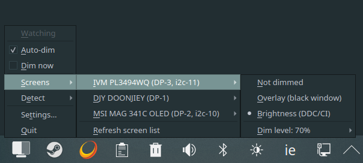

# Monitor Dimmer

Automatically dims your other monitors when you launch a game or play fullscreen media — and restores them when you're done.


---

## Features

- **Auto-detection** — dims when a Steam, Heroic (GOG/Epic) or any game from your library folders starts, when VLC goes fullscreen, or when YouTube, Netflix, Twitch or another supported video site plays fullscreen in the browser
- **Any number of screens** — choose which screens get dimmed and which stay untouched, each with its own mode and dim level
- **Manual control** — "Dim now" works regardless of detection; auto-dim can be switched off
- **Two dimming modes**, chosen per screen
  - **Black overlay** *(recommended)* — a borderless black window covers the screen, zero flicker, can go fully black, works on any screen (laptop panels and TVs too); clicks pass through it
  - **Hardware brightness** — lowers the monitor's own brightness over DDC/CI (`ddcutil` on Linux, the Monitor Configuration API on Windows), relative to the brightness you use, and puts it back afterwards
- **Finds your monitor by identity** — serial number / model, not the GPU port, so swapping cables doesn't make it dim the wrong screen; two identical monitors are told apart by connector
- **Works with borderless windowed games** — detection is process-based; optionally dim only while a game is fullscreen (on KDE this sees native Wayland windows too)
- **Safe restore** — if the daemon is stopped or crashes while a monitor is dimmed, the brightness is restored
- **System tray icon** — auto-dim on/off, dim now, per-screen mode, what to detect, settings (the daemon also runs without a tray)
- **Terminal config wizard** — change intensity, screens, poll interval and detection at any time
- **Starts automatically** at login via systemd user service
- **Interactive installer** — detects your monitors, game libraries, and walks you through setup

---

## Requirements

Python 3.10+ with `venv` support, on either system.

**Linux** — a systemd user session, developed on **KDE Plasma** (Wayland or X11)

- `PyQt6` — overlay window and monitor list (best from your distro; the installer can pip-install it otherwise)
- Optional:
  - `ddcutil` — hardware brightness mode (monitors must support DDC/CI)
  - `gdbus` (glib2) — VLC fullscreen detection, KWin window watcher
  - `xdotool` + `xprop` — fullscreen windows on desktops other than KDE (browser video, "dim only while fullscreen")
  - AppIndicator (`libappindicator-gtk3` / `gir1.2-ayatanaappindicator3-0.1`) — tray icon

**Windows 10 / 11** — nothing else to install. DDC/CI, the window list and the tray come from the operating system, and the installer pip-installs `PyQt6`, `pystray` and `Pillow` into a private virtual environment.

On Linux `pystray` and `Pillow` go into that same kind of private environment (`~/.local/share/monitor-dimmer/venv`), so nothing is pip-installed into your system Python.

### Install dependencies (Linux only)

**Arch / CachyOS / Manjaro**
```bash
sudo pacman -S python-pyqt6 ddcutil glib2 xdotool xorg-xprop libappindicator-gtk3
```

**Fedora / Bazzite / Nobara**
```bash
sudo dnf install python3-pyqt6 ddcutil glib2 xdotool xprop libappindicator-gtk3
```

**Debian / Ubuntu**
```bash
sudo apt install python3-venv python3-pyqt6 ddcutil libglib2.0-bin xdotool x11-utils gir1.2-ayatanaappindicator3-0.1
```

For hardware brightness your user needs access to `/dev/i2c-*`. On many distros:
```bash
sudo usermod -aG i2c $USER   # then log out and back in
```

---

## Installation

Run it in a terminal from your desktop session (the installer asks the compositor for the list of screens). Both ways below download into a new `monitor-dimmer` folder inside the current directory — it doesn't need to exist beforehand.

### Linux

**With git**

```bash
git clone https://github.com/jahrekza/monitor-dimmer
cd monitor-dimmer
python3 install.py
```

**Without git**

```bash
mkdir monitor-dimmer
curl -L https://github.com/jahrekza/monitor-dimmer/archive/refs/heads/main.tar.gz | tar xz -C monitor-dimmer --strip-components=1
cd monitor-dimmer
python3 install.py
```

### Windows

In PowerShell or Windows Terminal:

```powershell
git clone https://github.com/jahrekza/monitor-dimmer
cd monitor-dimmer
python install.py
```

Without git, download the repository as a ZIP, unpack it, and run `python install.py` in the unpacked folder. Nothing needs administrator rights — everything is installed for your user only.

If you would rather have a single file to double-click, and no Python on the machine at all, see [Building the Windows executables](#building-the-windows-executables).

### What the installer does

1. Check optional system tools and create the private Python environment
2. Let you pick the screens to dim and how (overlay or hardware brightness, per screen)
3. Ask what to detect: games (with Steam libraries and Heroic folders found automatically), VLC, video sites
4. Ask for the poll interval and whether to start at login
5. Install the programs, and set it to start at login (a systemd user service on Linux, the Run registry key on Windows)
6. Add a menu entry — a desktop entry on Linux, a Start menu shortcut on Windows — and optionally pin it to KDE favorites
7. Run a quick dim test so you can see the effect immediately

Everything is installed to your home directory (see [File locations](#file-locations)), so the download folder can be deleted afterwards.

### Updating

In the download folder:

```bash
git pull            # or, without git, run the curl command from above again
python3 install.py
```

If you deleted the folder, download it again as described above and run `python3 install.py`. The installer offers to keep your current settings and only update the program.

### Building the Windows executables

Everything above needs Python on the machine. `packaging/build_windows.py` turns the project into executables that do not:

```powershell
pip install pyinstaller PyQt6 pystray pillow
python packaging/build_windows.py
```

Two things land in `dist/`:

| | |
|---|---|
| `MonitorDimmer/` | The application — one folder with one executable |
| `monitor-dimmer-setup.exe` | One file carrying that folder inside it: the one to hand to someone |

That single executable plays every part, and `--role` says which: `daemon`, `overlay`, `settings` or `uninstall`. With no role at all it is the installer, so double-clicking it does the obvious thing. What it installs needs neither Python nor a virtual environment, and the uninstaller removes the program folder once it has exited.

**Smart App Control.** On a clean Windows 11 this is on by default, and it judges every executable by Microsoft's reputation service. A binary built minutes ago has no reputation, and Windows may simply refuse to start it:

```
OSError: [WinError 4551] An Application Control policy has blocked this file
```

with event 3118, *Smart App Control Block*, in the `Microsoft-Windows-CodeIntegrity/Operational` log. It is not a blanket ban on unsigned programs — the verdict is made per file, and most builds run until one does not. A signature from a certificate authority Microsoft trusts is the only dependable answer; a self-signed certificate does not count, and the feature cannot be turned back on once turned off. The Python installer above is unaffected, which is why both ways in are kept.

---

## Usage

Once installed the daemon runs silently in the background.

| Situation | What happens |
|-----------|-------------|
| Steam game launches | Chosen screens dim |
| Game from a library folder launches (Heroic, native, …) | Chosen screens dim |
| VLC goes fullscreen | Chosen screens dim |
| A video site goes fullscreen in the browser | Chosen screens dim |
| Game / video closes | Brightness restored |

### System tray

Look for the monitor icon in your taskbar. If it's hidden, click the `▲` arrow to expand hidden icons. Right-click for options:



- **Status** — what is happening right now (watching, dimmed by a game / VLC / video, manual)
- **Auto-dim** — turn automatic dimming on or off
- **Dim now** — dim the chosen screens right away, whatever is running
- **Screens** — every connected screen with *Not dimmed / Overlay / Brightness (DDC/CI)* and its *Dim level* (default, 30–100%); brightness is greyed out for screens without DDC/CI. *Refresh screen list* after plugging in a monitor
- **Detect** — games, games only when fullscreen, VLC fullscreen, video sites in fullscreen
- **Settings…** — open the configuration wizard in a terminal
- **Quit** — stop the daemon (restores everything)

Changes made in the tray are saved to the config.

### Configuration wizard

```bash
dimmer
```

```
  SCREENS
   1  Screens to dim           per screen: overlay / brightness, own dim level
   2  Default dim intensity    used by screens without their own level
   3  Test dim (3 s)
  DETECTION
   4  Games                    on/off · only when fullscreen
   5  Game folders             list, add, remove
   6  VLC fullscreen           on/off
   7  Video sites              on/off · site list (YouTube, Netflix, …)
  GENERAL
   8  Auto-dim                 on/off
   9  Poll interval            seconds
  10  Service                  start / stop / restart / start at login
   s  Save    q  Quit
```

Saving writes only what you changed, so changes made from the tray in the meantime are kept, and the running daemon picks the new settings up within a few seconds — no restart.

---------|-------------|
| Dim intensity | 0 = no change · 50 = half brightness · 100 = fully black |
| Poll interval | How often to check if a game is running (seconds) |
| Test dim | Dim the chosen screens for 3 seconds |
| Screens | Pick which screens are dimmed and how (overlay / hardware brightness) |
| Detection | Games, games only when fullscreen, VLC fullscreen, browser video |
| Start / Stop service | Control the systemd user service |

---

## How it works

```
┌─────────────────────────────────────────────────────┐
│  monitor-dimmer (daemon)                            │
│                                                     │
│  every N seconds:                                   │
│    scan /proc for Steam games and   ──► game found  │
│    processes from game_paths                        │
│    query VLC via MPRIS2 D-Bus       ──► fullscreen  │
│    fullscreen window titled YouTube ──► video       │
│                                          │          │
│                                     dim each chosen │
│                                     screen (overlay │
│                                     or brightness)  │
└─────────────────────────────────────────────────────┘
```

**Game detection** looks for processes with a `SteamGameId` (Steam and Proton games, Steam helpers excluded) and for processes whose executable — or Windows `.exe` started through Wine — lives inside one of the configured `game_paths`. This works whether the game runs fullscreen, borderless windowed, or windowed. With *fullscreen only* enabled, some window also has to be fullscreen.

**Fullscreen windows.** On KDE Plasma the daemon loads a small KWin script that reports fullscreen windows (title, process) over D-Bus whenever they change — native Wayland and X11 windows alike. On other desktops X11/XWayland windows are read with `xdotool` + `xprop`; native Wayland windows are invisible there, so leave *fullscreen only* off for native Wayland games.

**Video sites.** Browsers don't tell other programs whether a video is fullscreen or which site is playing, so the daemon looks for a fullscreen window whose title contains the name of a supported site, as a whole word (so *Plex* doesn't match "complex"). Built-in list:

| | Sites |
|---|---|
| Global | YouTube, Netflix, Twitch, Prime Video, Disney+, HBO Max, Max, Apple TV, Vimeo, Dailymotion, Kick, Crunchyroll, SkyShowtime, Paramount+, Plex, Jellyfin |
| Poland | Player.pl, Polsat Box Go, TVP VOD, CDA, CANAL+ |
| Ireland | RTÉ Player, Virgin Media Player, TG4 |

The list is `video_titles` in the config; edit it in `dimmer` → *Video sites* (where *Reset to the built-in list* restores it).

**VLC detection** queries every VLC instance's MPRIS2 D-Bus interface and only triggers when VLC reports `Fullscreen = true`.

**Overlay mode** opens a borderless, always-on-top, click-through PyQt6 window covering each overlay screen at the configured opacity. It doesn't take keyboard focus from the game. Advantages over hardware dimming:
- No monitor flickering or power cycling
- Can reach 100% black
- Instant on/off
- Works on screens without DDC/CI

Placing a window on a chosen screen is up to the compositor: KDE Plasma and X11 desktops honour it; on other Wayland desktops use hardware brightness if the overlay lands on the wrong screen.

**Hardware brightness** reads the monitor's current brightness, lowers it by the dim intensity (70% dim of brightness 60 → 18) and restores the saved value afterwards. The saved value is kept in `~/.local/state/monitor-dimmer/` until it has been restored, so a crash or `systemctl stop` mid-game doesn't leave the screen dark.

### Project structure

| File | Role |
|------|------|
| `src/monitor-dimmer` | Daemon: detection loop, dimming, tray menu |
| `src/monitor-dimmer-overlay` | Overlay window (PyQt6), also lists the screens |
| `src/dimmer` | Settings wizard |
| `src/dimmer_common.py` | OS-independent logic: config, screen matching, video sites, levels, saved brightness |
| `src/backend_linux.py` | Everything Linux-specific: ddcutil, `/proc` + Steam, VLC over MPRIS, KWin script / xprop, systemd, terminals |
| `src/backend_windows.py` | The same interface on Win32 APIs: DDC/CI through dxva2, monitor identity from the registry's EDID, Steam's `RunningAppID`, windows and job objects through user32/kernel32 |

| `packaging/build_windows.py` | Builds the Windows executables with PyInstaller |
| `packaging/app.py` | Entry point of that build: picks the program to run from `--role` |

The daemon, settings and installer reach the operating system only through the backend, which `dimmer_common.py` picks by platform.

---

## File locations

### Windows

| File | Purpose |
|------|---------|
| `%LOCALAPPDATA%\Programs\monitor-dimmer\` | Programs, the uninstaller, the icon and their private Python environment |
| `%LOCALAPPDATA%\Programs\monitor-dimmer\bin\` | `monitor-dimmer.cmd`, `monitor-dimmer-overlay.cmd`, `dimmer.cmd` |
| `%LOCALAPPDATA%\monitor-dimmer\` | Brightness to restore while a DDC dim is active, and the daemon's pid |
| `%APPDATA%\monitor-dimmer\monitor-dimmer.conf` | Configuration file |
| `%APPDATA%\Microsoft\Windows\Start Menu\Programs\Monitor Dimmer.lnk` | Start menu shortcut for the settings wizard |
| `HKCU\Software\Microsoft\Windows\CurrentVersion\Run` → `MonitorDimmer` | Starts the daemon at login |

That folder is not on your `PATH`, so run the wizard from the Start menu, or as `%LOCALAPPDATA%\Programs\monitor-dimmer\bin\dimmer.cmd`.

### Linux

| File | Purpose |
|------|---------|
| `~/.local/bin/monitor-dimmer` | Daemon launcher (`--restore` undoes a leftover dim) |
| `~/.local/bin/monitor-dimmer-overlay` | Overlay window launcher (`--list` prints the screens) |
| `~/.local/bin/dimmer` | Configuration wizard launcher |
| `~/.local/share/monitor-dimmer/` | Programs, the uninstaller and their private Python environment |
| `~/.local/state/monitor-dimmer/` | Brightness to restore while a DDC dim is active |
| `~/.config/monitor-dimmer.conf` | Configuration file |
| `~/.config/systemd/user/monitor-dimmer.service` | Systemd user service |
| `~/.local/share/applications/dimmer.desktop` | Desktop entry |

### Configuration file format

```ini
# Monitor Dimmer configuration
dim_level=70
poll_interval=5
auto_dim=true
detect_games=true
vlc_fullscreen=true
video_fullscreen=true
video_titles=YouTube,Netflix,Twitch,Prime Video,Disney+
require_fullscreen=false
game_paths=/home/user/.steam/steam/steamapps/common,/home/user/Games/Heroic
screen1_mode=ddc
screen1_level=50
screen1_connector=DP-3
screen1_mfg=IVM
screen1_model=PL3494WQ
screen1_sn=1187021300709
screen1_bus=11
screen2_mode=overlay
screen2_connector=HDMI-A-1
screen2_model=LG TV
```

`screenN_mode` is `off`, `overlay` or `ddc`; `screenN_level` (0–100) overrides `dim_level` for that screen. Screens that aren't listed are never touched.

**How screens are found.** Bus numbers and connector names belong to the GPU port, not the monitor, so they change when cables are swapped. The daemon looks for each screen by `sn`, then by `model`, and uses `connector` / `bus` only to tell identical monitors apart. A screen that is not found — switched off or unplugged — is skipped. Configs from older versions (`right_*` / `target_*` keys, or only a bus number) are read as `screen1`.

---

## Uninstall

```bash
monitor-dimmer --uninstall
```

(or `python3 uninstall.py` in the download folder). From a build made with `packaging/build_windows.py` there is no such command — use the executable instead:

```powershell
%LOCALAPPDATA%\Programs\monitor-dimmer\MonitorDimmer.exe --role uninstall
```

Add `--yes` to skip the question. Either way it stops the daemon, puts back the brightness of a monitor that was dimmed, and removes every installed file: the programs and their private Python environment, the config, the menu entry and, on Windows, the start-at-login registry key.

---

## Troubleshooting

**No monitors listed for hardware brightness**
```bash
sudo usermod -aG i2c $USER
# log out and back in, then:
ddcutil detect
```
Monitors listed as *Invalid display* don't support DDC/CI — use overlay mode for them.

**Tray icon not visible**
Click the `▲` arrow in your taskbar to expand hidden icons. On KDE: right-click the taskbar → *Configure System Tray* → find Monitor Dimmer → set to *Always visible*. Without an AppIndicator/tray host the daemon keeps working; use `dimmer` to configure it.

**Service not starting**
```bash
systemctl --user status monitor-dimmer.service
journalctl --user -u monitor-dimmer.service -n 50
```
The service starts with `graphical-session.target`. Desktops that don't activate that target need `systemctl --user start monitor-dimmer` from their autostart.

**The wrong monitor dims, or none at all**
Tray → *Screens*: set the right screen to *Overlay* or *Brightness* and the others to *Not dimmed*. After plugging in a monitor use *Refresh screen list*.

**A video site is not detected**
The browser window must be fullscreen (video fullscreen, e.g. `F` on YouTube) and its title must contain the site's name — check the tab title and add that name in `dimmer` → *Video sites*. On desktops other than KDE install `xdotool` and `xprop`; native Wayland browser windows can only be seen on KDE.

**Dim not triggering for a game**
Steam games are found automatically. Other games must run from inside one of the configured `game_paths` — re-run the installer or edit `game_paths` in the config. If *fullscreen only* is on, try turning it off.

---

## License

MIT — do whatever you want with it.
